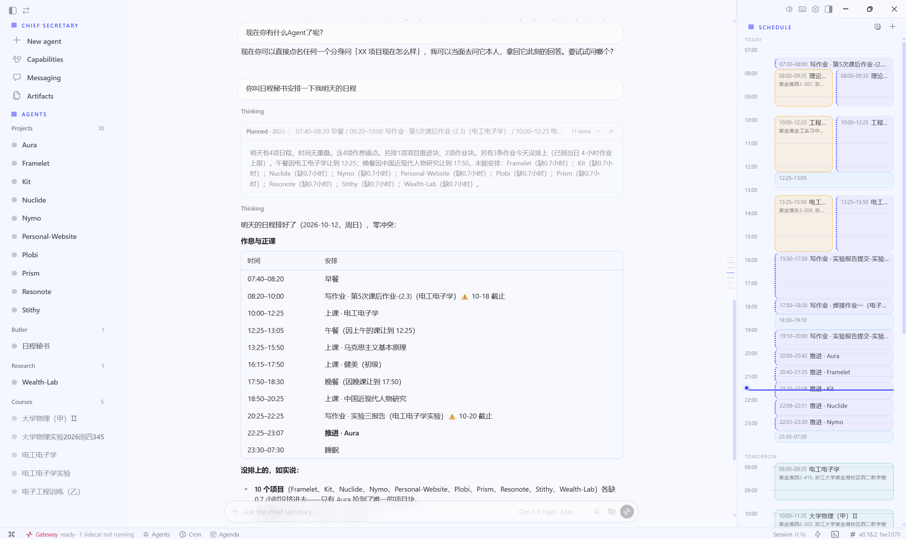

<div align="center">

# Plobi

**面向多应用时代的 AI 秘书（AI Secretary）**

Plobi 是一款桌面 AI 智能体，将您免费额度内的 AI 工具 —— Cursor、Antigravity、WorkBuddy、Marvis、DevEco 以及 API 服务商 —— 统一编排为一位专属秘书。它跟踪额度、调度任务、管理日程，并运行无人值守的自动化流程，让您无需在多个应用之间来回切换。

[](https://www.python.org/)
[](https://www.electronjs.org/)
[](https://www.typescriptlang.org/)
[](#license)

[](https://github.com/deyu-deng/Plobi/actions/workflows/lint.yml)
[](https://github.com/deyu-deng/Plobi/actions/workflows/arch-gates.yml)
[](https://github.com/deyu-deng/Plobi/actions/workflows/action-pin-audit.yml)
[](https://github.com/deyu-deng/Plobi/actions/workflows/dependency-health.yml)
[](https://github.com/deyu-deng/Plobi/actions/workflows/dependabot/update-graph)

</div>

---

## Screenshot



*Plobi 桌面控制台 —— 与您的 L1 秘书对话、查看委派中的 Agent，并在同一界面浏览日程时间线。*

---

## 为什么选择 Plobi？

每个 AI 工具都会赠送免费额度，但全部用起来意味着不断切换上下文。Plobi 位于它们之上：

- **统一额度感知** —— 了解哪些工具还有剩余额度，并据此分派工作
- **三级委派** —— 秘书（L1）派发给项目 Agent（L2），项目 Agent 再调度执行体（L3），包括外部 AI 应用
- **本地 AI 网关** —— 在统一的 OpenAI 兼容端点后聚合各桌面 AI 应用的额度
- **日程与自动化** —— 基于聊天记录提取日程、确认流程、定时摘要与提醒
- **桌面原生** —— Electron 应用，三栏控制台，而非终端或网页标签页

## 功能特性

### Agent 编排
- **L1 秘书** —— 对话式入口，做规划决策，与您对话
- **L2 项目 Agent** —— 领域专精，拥有自己的上下文与子 Agent 阵容
- **L3 执行体** —— 内置工具 Agent、外部 AI 应用（Cursor、Antigravity、WorkBuddy、Marvis、DevEco）与硬件 HID 设备

### 额度管理
- **额度池** —— 跟踪各 API 服务商与桌面应用的健康状态与剩余额度
- **健康探测** —— 周期性探测，按来源标注状态（健康 / 冷却 / 需重新认证 / 停用）
- **故障转移路由** —— 当服务商异常或额度用尽时自动切换来源
- **管家提醒** —— 定时晨报、待办摘要与额度预警通知

### 本地 AI 网关（aigw）
- 运行于 `localhost` 的 OpenAI 兼容 `/v1/chat/completions` 端点
- 三种集成模式：spawn-CLI（合规）、GUI 自动化、逆向 API
- 粘性会话、熔断、限流、加密凭据保险库
- 已支持：Antigravity、WorkBuddy、Marvis、Cursor（部分）

### 日程与记忆
- **聊天记录采集** —— 以隐私优先黑名单从聊天平台提取日程变更
- **待确认机制** —— 提议事件须经您批准后才写入日历
- **心智记忆** —— FTS5 会话搜索、从经验创建技能、跨会话回忆

### 桌面控制台
- 三栏布局：Agent 名单 · 对话 · 日程时间线
- 每个 L2 Agent 的工作台：子 Agent 状态、外派应用会话、文件、看板、产物
- 主题系统：种子色派生、全局密度 / 圆角令牌

## 技术栈

| 层级 | 技术 |
|-------|-----------|
| 后端 | Python 3.11、LangGraph Agent 运行时 |
| 桌面端 | Electron 40、React 19、TypeScript、Vite |
| UI | Tailwind CSS、assistant-ui、自定义设计令牌系统 |
| 网关 | Python、FastAPI、子进程 + Windows UI 自动化 |
| 存储 | SQLite（日程、会话、额度）、JSON 配置 |
| 调度 | 内置 cron + 持久化任务注册表 |

## 快速开始

### 前置要求
- Python 3.11+
- Node.js 20+ 与 npm
- Git

### 安装

```bash
git clone https://github.com/deyu-deng/Plobi.git
cd Plobi

# Python 后端（推荐 uv）
uv venv --python 3.13 && uv sync --extra dev --extra acp --extra messaging --extra web --extra anthropic
source .venv/bin/activate                # macOS/Linux
# .venv\Scripts\activate                # Windows
# Windows 一键环境初始化：
#   powershell -ExecutionPolicy Bypass -File scripts/install.ps1

# SOCKS 代理测试套件所需（使用上述 extras 的 uv sync 会移除这两项）
uv pip install aiohttp-socks==0.11.0 python-socks

# 桌面应用
cd apps/desktop
npm install
```

### 运行

```bash
# 终端 Agent（CLI）
plobi

# 桌面应用（热重载开发模式）
cd apps/desktop
npm run dev
```

### 配置服务商

通过桌面应用「设置 → Providers」添加 API 密钥，或使用环境变量：

```bash
# OpenAI 兼容服务商
export OPENAI_API_KEY=sk-...
# Zhipu / Z.ai
export GLM_API_KEY=...
# 自定义 OpenAI 兼容端点
export OPENAI_BASE_URL=https://api.example.com/v1
```

## 架构

```
┌─────────────────────────────────────────────────┐
│  Desktop Console (Electron / React)             │
│  ┌──────────┬──────────────┬────────────────┐  │
│  │ Agents   │ Conversation │ Agenda / Files │  │
│  │ Roster   │ (ChatSurface)│ Timeline       │  │
│  └──────────┴──────────────┴────────────────┘  │
└──────────────────────┬──────────────────────────┘
                       │ HTTP / IPC
┌──────────────────────▼──────────────────────────┐
│  Python Backend                                 │
│  ┌─────────┐  ┌──────────┐  ┌───────────────┐  │
│  │ L1 Sec. │→ │ L2 Agent │→ │ L3 Executors  │  │
│  └─────────┘  └──────────┘  └───────┬───────┘  │
│                                     │           │
│  ┌─────────────┐  ┌────────────┐   │           │
│  │ Quota Pool  │  │  aigw      │←──┘           │
│  │ (health)    │  │ (routing)  │               │
│  └─────────────┘  └─────┬──────┘               │
└──────────────────────────┼──────────────────────┘
                           │
            ┌──────────────┼──────────────┐
            ▼              ▼              ▼
       API Providers   Desktop Apps   Hardware HID
       (zhipu, etc.)   (Cursor, ...)   (Pico 2W)
```

## 项目结构

```
├── agent/              # 核心 Agent 运行时（LangGraph）
├── aigw/               # 本地 AI 网关（OpenAI 兼容）
├── apps/desktop/       # Electron 桌面应用
├── plobi/             # Plobi 专属模块
│   ├── agenda/         # 日程服务与采集器
│   ├── quota/          # 额度池与来源探测
│   ├── delegation/     # L3 委派守卫
│   ├── butler/         # 定时报告与提醒
│   └── collectors/     # 聊天记录采集
├── plugins/            # Agent 插件（记忆、平台等）
├── skills/             # 可复用 Agent 技能
├── tools/              # 工具实现
├── gateway/            # 多平台消息网关
├── plobi_cli/         # CLI 界面
└── tests/              # 测试套件
```

## 贡献

欢迎贡献代码。请：

1. Fork 本仓库并创建功能分支
2. 为新功能编写测试
3. 确保 `pytest` 与 `npm run test` 通过
4. 提交带有清晰描述的 Pull Request

### 开发说明

- 后端测试：`pytest tests/`
- 前端类型检查：`cd apps/desktop && npx tsc --noEmit`
- 前端测试：`cd apps/desktop && npm run test`

## 许可证

MIT License —— 详见 [LICENSE](LICENSE)。

---

## 致谢

Plobi 是 **[Hermes Agent](https://github.com/NousResearch/hermes-agent)**（Nous Research 出品）的一个分支，其 Agent 核心、消息网关、TUI、插件/技能系统与 CLI 均源自该项目。MIT 许可证全文及两份版权声明见 [`LICENSE`](LICENSE) 与 [`NOTICE`](NOTICE)；其余第三方依赖见 `pyproject.toml`、`uv.lock`、`package.json` 与 `package-lock.json`。

<div align="center">

基于 [Hermes Agent](https://github.com/NousResearch/hermes-agent) 构建。

</div>
